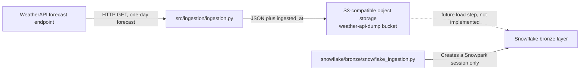

# Weather Data Pipeline: Design Document

## Purpose and status

This repository is an early-stage weather-data ingestion project. Its implemented path fetches a forecast for Bengaluru and writes the API response to an S3-compatible object store as JSON. A separate Snowflake script creates a Snowpark session, but no code currently transfers objects from storage into Snowflake or transforms them.

This document describes the behavior present in the repository, not a completed end-to-end analytics system. In particular, there is no scheduler, automated deployment, test suite, or implemented Snowflake ingestion job in the files inspected.

## Architecture at a glance



The two Python scripts are independent when run: the weather collector writes an object, while the Snowflake script connects to Snowflake. The latter does not read the object store or create a table.

## Repository layout

| Path | Responsibility |
| --- | --- |
| `src/ingestion/ingestion.py` | Calls WeatherAPI, adds an ingestion timestamp, and uploads the JSON payload. |
| `src/logs/` | Destination for the collector's `ingestion.log` file. |
| `snowflake/bronze/snowflake_ingestion.py` | Builds a Snowpark session using environment credentials and fixed account context. |
| `requirements.txt` | Declares the HTTP, AWS-compatible S3 client, and dotenv dependencies used by the collector. |
| `.gitignore` | Excludes `.env`, `.venv`, and `*.log` from Git. |

## Data flow

1. The collector loads environment variables from `.env` using `python-dotenv`.
2. It creates a `requests.Session` with an `HTTPAdapter` and a `urllib3.Retry` policy: up to five retries, exponential backoff factor `1`, and retryable statuses `408`, `429`, `500`, `502`, `503`, and `504`.
3. It requests WeatherAPI's forecast endpoint for `Bengaluru`, with `days=1`, `aqi=no`, and `alerts=no`.
4. On HTTP 200, it parses the response body as JSON and adds `ingested_at`, generated with `datetime.now().isoformat()`.
5. It uploads the JSON to the `weather-api-dump` bucket through the configured S3-compatible endpoint.

### Object naming

The object key is partitioned by the machine's current local date and minute:

```text
weather-data/year=YYYY/month=MM/day=DD/weather-data-HHMM.json
```

The payload is the provider response with the additional `ingested_at` field. The key does not include seconds or a unique run ID, so multiple successful runs in the same minute can target the same key and overwrite an earlier object. The timestamp is local and timezone-naive; it may not correspond to the timezone used by WeatherAPI's forecast timestamps.

## Components

### Weather collector

`harvest_weather_data()` coordinates the request and upload. `create_request_session()` configures HTTP retries. `s3_client_initialize()` creates a `boto3` S3 client with explicit credentials and the Impossible Cloud endpoint. The script runs the collector when invoked directly:

```bash
python src/ingestion/ingestion.py
```

Run it from the repository root: the log file is opened at the relative path `src/logs/ingestion.log`. The `src/logs/` directory is present in the repository.

### Snowflake connection script

`snowflake/bronze/snowflake_ingestion.py` loads `.env`, reads Snowflake account, user, and password values, and creates a `Session`. It hardcodes the role (`ACCOUNTADMIN`), warehouse (`COMPUTE_WH`), database (`ECON_AGENT_DB`), and schema (`ANALYTICS`). The imported Snowpark functions alias is currently unused. The script does not query storage, write a bronze table, or close the session explicitly.

## Configuration and prerequisites

Create a local `.env` file in the repository root. It is excluded from Git; do not commit credentials.

| Variable | Used by | Purpose |
| --- | --- | --- |
| `WEATHER_API_KEY` | Weather collector | WeatherAPI credential. |
| `IMPOSSIBLE_CLOUD_ACCESS_KEY` | Weather collector | Object storage access key. |
| `IMPOSSIBLE_CLOUD_SECRET_KEY` | Weather collector | Object storage secret key. |
| `SF_ACCT_ID` | Snowflake script | Snowflake account identifier. |
| `SF_USER_NAME` | Snowflake script | Snowflake username. |
| `SF_PAT` | Snowflake script | Value passed as the Snowflake password. |

Install the dependencies listed for the collector with:

```bash
python -m pip install -r requirements.txt
```

The Snowflake script imports `snowflake.snowpark`, but `snowflake-snowpark-python` is not listed in `requirements.txt`. Install a compatible Snowpark Python package separately before running that script, or add it to the project's dependency manifest as part of packaging work.

## Failure behavior and operational notes

- Request exceptions are logged and re-raised. The configured adapter retries the listed transient statuses before returning a response.
- A 200 response proceeds to storage upload. Other returned statuses are logged; they do not raise an exception in the collector's explicit status handling.
- Storage client creation and upload errors are not caught by the collector, so they propagate to the caller.
- Logging writes to `src/logs/ingestion.log`. The collector uses both a module logger and the root logger, and no logging level is configured here; informational messages may therefore not appear with the default logging configuration.
- The request URL is built with `http://` and contains the API key as a query parameter. Use HTTPS to protect credentials in transit, and avoid logging full request URLs. The current request has no explicit timeout.
- The collector hardcodes the city, endpoint, and bucket. Missing or invalid environment variables are not validated at startup.
- No schedule or orchestration is defined. A user or external scheduler must invoke the collector.
- `.env`, `.venv`, and log files are ignored by Git. Keep credentials out of source control and rotate them if they are exposed.

## Design gaps and recommended next steps

These are follow-up opportunities, not implemented features:

1. Make ingestion configuration explicit and validate required settings before making network calls.
2. Use HTTPS, set connection/read timeouts, and make the object key collision-resistant (for example, include seconds or a run identifier).
3. Define a Snowflake load step that reads the landed JSON, writes a bronze table, and manages the Snowpark session lifecycle.
4. Add `snowflake-snowpark-python` to the dependency manifest if Snowflake execution is a supported project workflow.
5. Configure consistent structured logging, including a clear success/failure signal suitable for a scheduler.
6. Add tests around response handling, object-key generation, payload metadata, and upload behavior; use mocked HTTP and storage clients to avoid external calls.
7. Document the chosen schedule, retention policy, expected data volume, and operational alerting when those requirements are decided.